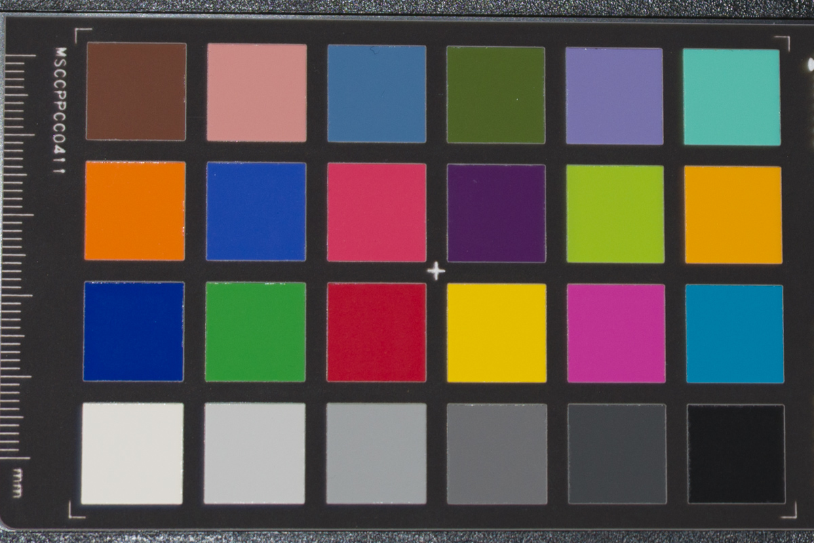
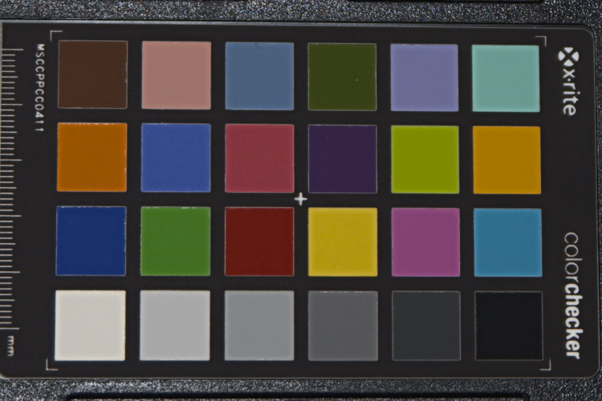
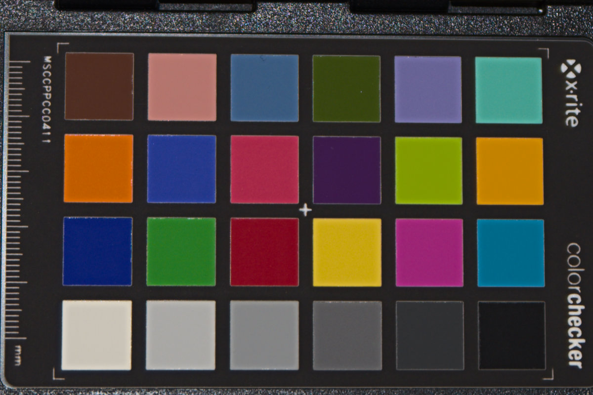
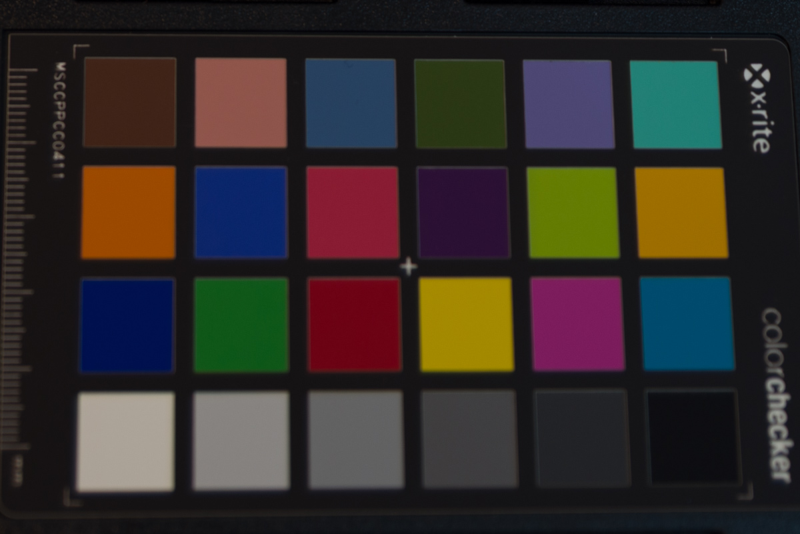
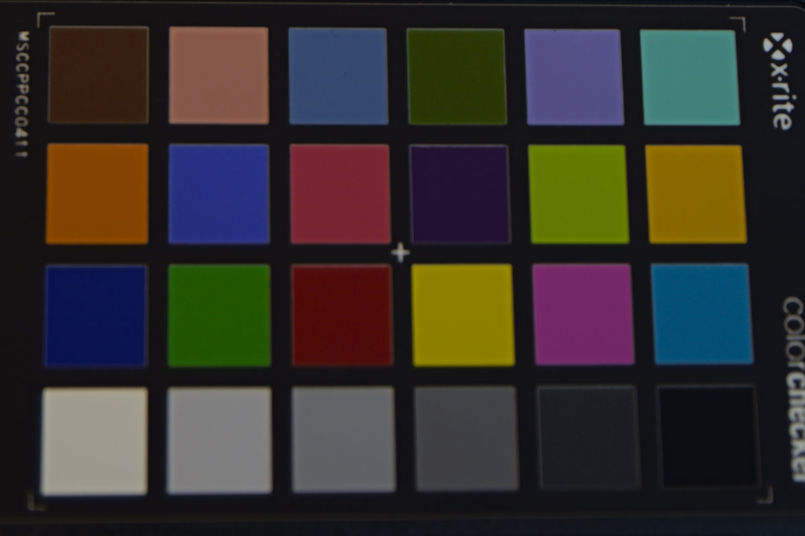
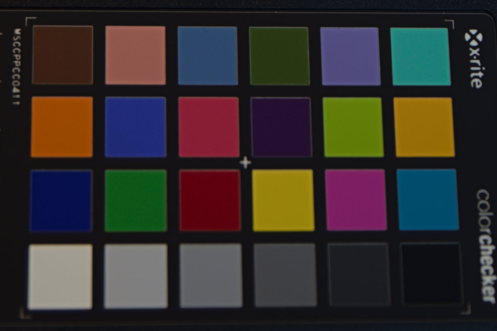

# Nikon D750 ColorChecker presets for LightCraft

Two LightCraft presets that correct the colour rendering of Nikon D750 raw files (NEF), tuned against a
ColorChecker-based DNG camera profile in Lightroom. LightCraft has no measured D750 profile yet and
cannot load `.dcp` files, so these presets approximate the profile with LightCraft's own sliders.

Both presets are in one file, `presets/D750.lcpreset`:

| Preset | Use for |
|---|---|
| D750 ColorChecker Outdoor 2026-10-17 | Daylight and flash |
| D750 ColorChecker Indoor 2026-10-17 | Warm indoor light (LED / tungsten) |

For mixed light, pick the preset that matches the dominant light source.

## Before / after

Both LightCraft columns use the same white balance (picked on the grey row) and exposure; the only
difference is the preset.

**Daylight / flash**

| Lightroom + ColorChecker DCP (reference) | LightCraft, no preset | LightCraft + Outdoor preset |
|---|---|---|
|  |  |  |

**Indoor**

| Lightroom + ColorChecker DCP (reference) | LightCraft, no preset | LightCraft + Indoor preset |
|---|---|---|
|  |  |  |

## How to use

1. In LightCraft, import `D750.lcpreset` via the Presets panel (Import). This adds both presets.
2. Select your D750 photos (search `camera:d750`) and apply the matching preset.
3. Then set exposure and white balance per photo as usual. The presets deliberately contain no
   exposure or white balance (neither temperature nor tint). Set white balance on something neutral;
   the presets were tuned on correctly white-balanced chart shots and look wrong on a colour cast.

Applying a preset also sets the profile to LightCraft's **Color** profile (`lc.color`) at 100 %.

Use the presets on **Nikon D750 files only**. They compensate LightCraft's current colour estimate
for this camera; on other cameras they will distort colour.

## What the presets contain

Profile, Saturation/Vibrance, Calibration and Color Mixer. Point Color and B&W mix are stored at zero.

| Setting | Outdoor | Indoor |
|---|---|---|
| Profile | Color, 100 % | Color, 100 % |
| Saturation / Vibrance | +32 / +8 | 0 / +4 |
| Shadows tint | +2 | +2 |
| Red primary hue / saturation | −30 / −10 | −18 / −2 |
| Green primary hue / saturation | +20 / +19 | +24 / +19 |
| Blue primary hue / saturation | +8 / +19 | −8 / +8 |

Color Mixer (hue / saturation / luminance):

| Band | Outdoor | Indoor |
|---|---|---|
| Red | −6 / +1 / +37 | +1 / +13 / +13 |
| Orange | +20 / +2 / +40 | +8 / 0 / +24 |
| Yellow | +3 / +2 / +29 | −9 / +2 / +13 |
| Green | +12 / −4 / +16 | +7 / −14 / +4 |
| Aqua | +4 / +15 / −1 | +4 / +15 / −11 |
| Blue | −12 / +8 / −35 | −11 / +5 / −10 |
| Purple | +8 / +4 / −14 | 0 / 0 / −14 |
| Magenta | +8 / +13 / −3 | +12 / +6 / −3 |

Accuracy against the Lightroom reference, mean ΔE2000 over the 24 patches (lower is better; about 1–2
is barely visible):

| | No preset | First, visually matched version (2026-10-16) | Current version |
|---|---|---|---|
| Daylight / flash | 5.8 | 4.4 | **1.5** |
| Indoor | 3.8 | 3.8 | **1.5** |

## Method

### 1. Chart shots

- Target: X-Rite ColorChecker Passport, classic 24-patch side.
- Camera: Nikon D750, firmware 1.15, ISO 100, raw (NEF), chart lit evenly from the front (light at about 90° to the chart surface).
- Exposure: white patch bright but not clipped.
- Two shots: one lit by the built-in flash (stands in for daylight) and one under indoor LED/tungsten
  light. Both were used to build the profile; there is no separate validation shot.

Capture settings, read from the NEFs:

| | Daylight / flash | Indoor |
|---|---|---|
| Lens | Tamron SP 24-70mm f/2.8 Di VC USD (A007N) at 46 mm | same |
| Exposure | M, 1/100 s, f/3.2, ISO 100 | M, 1/30 s, f/3.2, ISO 100 |
| Flash | Built-in, TTL-BL, rear curtain | off |
| White balance (camera) | Auto1 (R/B multipliers 2.07 / 1.31) | Auto1 (R/B multipliers 1.77 / 1.58) |
| Raw format | 14-bit lossless compressed NEF, 6032 × 4032, black level 600 | same |
| Picture Control / Active D-Lighting | Standard / Auto | Standard / Auto |

Picture Control, Active D-Lighting and the camera's white balance only affect the embedded JPEG
preview and Nikon's own software, not the raw data. They do not influence the presets.

### 2. Reference profile (Lightroom)

1. Exported the flash and indoor NEFs as DNG copies (Lightroom: File ▸ Export, format DNG).
2. Calibrite PROFILER ▸ camera calibration ▸ *Dual Illuminant DNG*: loaded both DNGs, checked the
   patch grid, created the profile `20261016_NikonD750_DualIllumination_ColorCheckerPassport.dcp`.
3. Lightroom Classic 15.6: applied the profile, white balance from the second-lightest grey patch,
   all other settings at zero.

### 3. Matching in LightCraft

LightCraft 0.8.0. The first version was matched by eye. The current version was fitted numerically
with `lightcraft-cli render`:

1. Render the chart NEF with candidate settings, sample the centre of all 24 patches, and compare them
   in CIELAB with the same patches in the Lightroom reference render (ΔE2000).
2. Adjust one slider at a time (Saturation, Vibrance, the seven Calibration sliders and the 24 Color
   Mixer sliders), keeping any change that lowers the mean ΔE, with step sizes shrinking from 16 to 2.
3. Exposure and white balance were fitted too, so they don't distort the comparison, but they are not
   stored in the presets.
4. A small penalty on large slider values keeps the corrections moderate, so they stay usable on real
   photos rather than only on the chart.

Exposure and white balance used for the chart renders:

| | Daylight / flash | Indoor |
|---|---|---|
| White balance | 6281 K, tint −1 | 5343 K, tint −8 |
| Exposure | −0.56 | −0.60 |

Seven Calibration sliders and an eight-band mixer cannot reproduce the full hue/saturation table of a
DCP, so small differences remain.

## Files

| Path | Content |
|---|---|
| `presets/D750.lcpreset` | Both LightCraft presets |
| `profiles/20261016_NikonD750_DualIllumination_ColorCheckerPassport.dcp` | Dual-illuminant DNG camera profile (colour matrices for Cool White Fluorescent and D55), for Lightroom / Camera Raw / RawTherapee, and for LightCraft once `.dcp` import lands |
| `raw/` | The two chart NEFs (flash, indoor) |
| `images/` | Chart renders shown above |

## Limitations

- Tuned for one camera body; other D750 bodies should be close but are untested.
- Tuned with LightCraft 0.8.0. LightCraft's rendering is still changing, so a later version may
  need slightly different values.
- Fitted to one chart shot per light source, against Lightroom's rendering of the DCP rather than
  measured patch values.
- Tuned on a flash-lit chart, not real daylight. Flash is close to daylight, but untested in sun or
  shade.
- Orange and red luminance are raised noticeably (Outdoor +40 / +37). Skin falls in these bands, so
  check faces; lower Orange luminance if skin looks too bright.

## Licence

Everything in this repository (presets, profile, raw files and images) is released under
[CC0 1.0](https://creativecommons.org/publicdomain/zero/1.0/). Use it however you like, including in
LightCraft itself.
